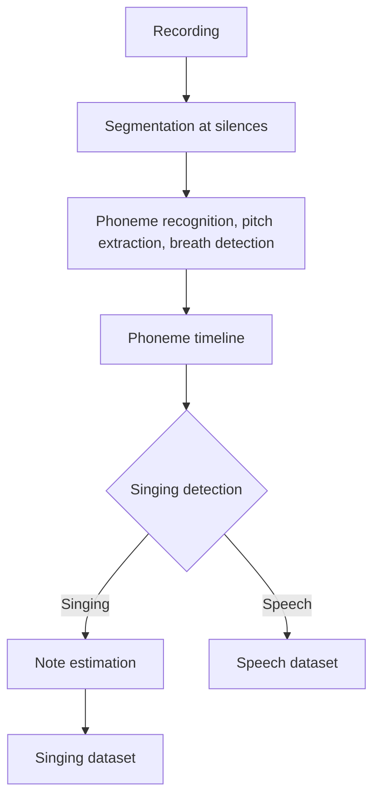

# QSinger

A method for training Japanese DiffSinger singing voice synthesis models from unlabeled singing and speech recordings alone.

## Abstract

Training a singing voice synthesis model of the DiffSinger family requires labels in which phoneme sequences, phoneme durations, and note sequences are aligned with each recording. Such labels must be either written manually or produced with lyric text and a forced alignment tool, which makes labeling the largest cost for individuals who wish to build a model of their own voice.

QSinger is a training method that requires no input other than WAV or FLAC recordings. Recordings are first segmented at silences, and a phoneme recognizer fine-tuned on labeled data, a breath detector, a classifier that distinguishes singing from speech, and a note estimator are then applied in sequence to produce labels in the DiffSinger training format.

## Introduction

The quality of a singing voice synthesis model depends heavily on the accuracy of its training labels. Labeling, however, takes considerably more time than recording itself. Most existing tools take lyric text as input and perform forced alignment, so lyrics that exactly match the recordings must be prepared separately, and improvised singing or speech recordings are difficult to process.

QSinger aims to eliminate this preparation step. The user specifies only a folder of recordings, and phoneme recognition, the separation of breaths from silence, the separation of singing from speech, and note estimation are all performed within the analyzer. Speech recordings carry no note information and therefore cannot be used for the variance model, but because they contain timbre and pronunciation information, they are used to train the acoustic model.

## Background

DiffSinger consists of an acoustic model, which generates mel spectrograms from phoneme sequences, phoneme durations, and pitch, and a variance model, which predicts expressive curves such as phoneme duration, pitch, and energy from phoneme sequences and note sequences. Both models require time-aligned labels at the phoneme level during training, and the variance model additionally requires note sequences.

Speech recognition models based on Connectionist Temporal Classification (CTC) emit either a token or a blank at each frame, and the final token sequence is obtained by removing repeated tokens and blanks. Because CTC models tend to concentrate probability at the frame where a token begins and to emit blanks thereafter, the positions of the emitted tokens correspond to phoneme onsets but do not directly indicate phoneme durations.

## Methodology

The overall procedure is shown below. The analyzer divides recordings into segments, constructs a phoneme timeline for each segment, and adds notes to the segments classified as singing.

### Segmentation

Recordings are converted to 44.1 kHz mono and then split wherever the RMS level, measured every 10 ms, remains more than 40 dB below the maximum level of the recording for at least 0.3 s. A short portion of silence is retained at both ends of each segment so that the onset and offset of an utterance are not truncated, and segments shorter than 1 s are discarded. Segments longer than 15 s are split again at the quietest frame in their latter half.

### Phoneme Transcription

Phoneme recognition uses the ZIPA-CR small CTC model, pretrained on IPA units, fine-tuned on labeled singing and speech data. The training targets for fine-tuning are the canonical IPA spellings of each phoneme. At inference, only the IPA characters that appear in the Japanese phoneme table are permitted, the most probable token is selected at each frame, and the resulting IPA sequence is converted into Japanese phonemes according to the phoneme table. Consonants marked with a length mark are split into a geminate and the consonant itself.

Since the CTC output indicates only the onset of each phoneme, each phoneme is assumed to begin at the frame where it is emitted and to continue until the onset of the next phoneme or the beginning of a silence. Silence is defined as a region in which the level remains more than 40 dB below the maximum level of the segment for at least 0.1 s. The confidence of a segment label is computed as the mean probability of the selected tokens multiplied by the proportion of IPA symbols successfully converted into phonemes, and segments with low confidence are excluded from the training data.

### Breath Detection

Breaths are difficult to distinguish from silence or voiceless consonants using level or spectral flatness alone. Breath presence is therefore determined every 10 ms by a small one-dimensional convolutional classifier that takes log-mel spectrograms as input. Because breath frames make up a small fraction of the data, the positive class is weighted during training, but only by the square root of the class ratio rather than the ratio itself, in order to prevent excessive detection. The decision threshold is set to the value that maximizes the F1 score on items held out from training.

Detection results are applied only to unvoiced frames in which no pitch is detected. At the end of a vowel, a longer duration is required so that devoiced vowels are not mistaken for breaths, and noise immediately following a consonant onset is regarded as part of the consonant and excluded from breaths.

### Singing Detection

The classifier that distinguishes singing from speech uses the same architecture as the breath detector, but averages the frame-level outputs over the entire segment to produce a single decision. Because pitch stability alone cannot reliably separate speech from singing with strong vibrato or rapidly changing notes, the differences in vocal delivery are learned directly from the spectrum.

When speech is misclassified as singing, the variance model learns the pitch and rhythm of speech as if they were singing, which is more harmful than missing part of the singing. The decision threshold is therefore set to the lowest value at which the rate of speech classified as singing does not exceed 2%. In addition, the training data should contain both singing and speech from the same speakers, so that the classifier learns vocal delivery rather than timbre or recording conditions.

### Note Estimation

Note boundaries and pitches of segments classified as singing are estimated with the openvpi GAME model, using its default inference settings. Segments in which every note is estimated as a rest carry no note information and are therefore treated as speech segments.

## License

QSinger is released under the MIT License. External components are subject to their own licenses: DiffSinger, icefall, k2, and RMVPE are released under the Apache-2.0 License, the GAME and ZIPA code under the MIT License, and the ZIPA pretrained weights under the CC BY 4.0 License.

## References

- DiffSinger: [`openvpi/DiffSinger`](https://github.com/openvpi/DiffSinger)
- GAME: [`openvpi/GAME`](https://github.com/openvpi/GAME)
- ZIPA: [`lingjzhu/zipa`](https://github.com/lingjzhu/zipa), [`anyspeech/zipa-small-crctc-300k`](https://huggingface.co/anyspeech/zipa-small-crctc-300k)
- icefall: [`k2-fsa/icefall`](https://github.com/k2-fsa/icefall)
- k2: [`k2-fsa/k2`](https://github.com/k2-fsa/k2)
